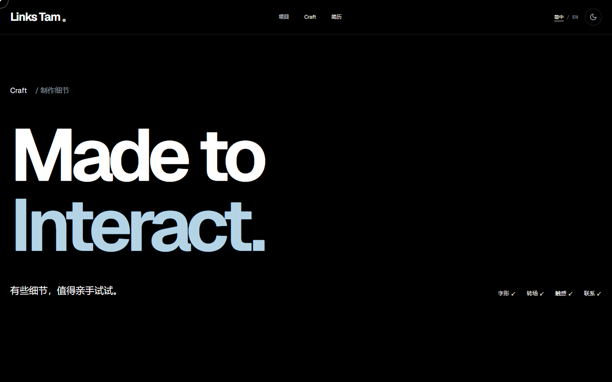

# Links Tam Portfolio · V1.2

沿用 Sazzad Ali MIT 工程的个人作品集。保留电影式开屏、Links 签名与独立 Craft 彩蛋、About 编译、Projects 横向展览、Skills Galaxy、3D Memory Keys、私有简历和独立游戏社区。已有内容与项目数据继续共用，未重新搭建网站。



## 两种运行目标

|目标|内容|运行方式|
|---|---|---|
|FULL_NODE|完整交互、动态社区接口、服务端简历鉴权与 PDF|Next.js build + next start，私有资料单独提供|
|PAGES_PUBLIC|公开交互、项目、游戏资料、公开履历概览|生成独立静态 target，output:export，无密码框/PDF/API|

默认源码是 FULL_NODE；不会为 Pages 牺牲服务端功能。Pages 从同一套 src/public 构建，生成目录禁止手改。企业证明文件、私有简历、密码配置和浏览器私有证据均不在发行包中。完整功能与限制见 [架构](docs/CODE_ARCHITECTURE.md) 和 [安全](docs/PRIVATE_RESUME_SECURITY.md)。

## 本地运行

使用 Node 24.22.2、npm 11.19.1（本次实际版本），在 package.json 所在目录运行：

```sh
npm ci --ignore-scripts
npm run dev
```

打开 http://127.0.0.1:3006 。生产本地检查先停止 dev，然后：

```sh
npm run typecheck
npm run lint
npm run format:check
npm run build
npm start
```

没有 private/resume 配置时简历默认拒绝访问，不会自动公开。服务器配置步骤见安全教程；不要将任何私人文件放 public。真实服务器状态未接入时继续显示规划/未接入。

静态子路径预览（PowerShell）：

```powershell
$env:PAGES_BASE_PATH='/links-tam-portfolio'
npm run build:pages
node scripts/serve-pages.mjs
```

打开 http://127.0.0.1:3010/links-tam-portfolio/ 。用户名根站设空 PAGES_BASE_PATH 并重新构建。不能用 CSS zoom 或更改 DPR 冒充原生缩放；15档真实 API 测量与人工菜单确认的边界见 [缩放验收](docs/ZOOM_25_TO_500_ACCEPTANCE.md)。

## 验证

服务在3006运行后，`npm test` 测Craft/键盘/媒体/社区；`npm run test:memory` 测按需3D和真实context loss；`npm run test:rebuild:status` 测状态边界。Chrome须单独安装。`test:resume-access` 需要本人在当前进程提供 LINKS_RESUME_QA_PASSWORD 和私有正式PDF，不能写进源码或Actions。视频和私有PDF截图留在 private，不上传。

V1.2可复现脚本在 scripts/v12-*；原生缩放脚本需要Playwright Chromium与测试扩展权限，记录tabs.setZoom/getZoom、CSS视口与实际截图，不能据此声称所有显示器/浏览器菜单都已人工验证。独立证据包包含真实失败与复测结果。

## 目录

```text
src/app/                  中英文路由、metadata、服务端API
src/components/portfolio/ Sazzad动画与首页
src/components/links/     Craft、Memory Keys、Resume、Community
src/content/              统一事实与真实项目媒体
src/lib/                  GSAP、返回恢复、服务端鉴权
src/styles/               设计Token与布局修复
public/                   经审核公开网站素材
scripts/                  双目标构建、预览、验证
deploy/                   next start/systemd/Nginx/切换脚本
docs/                     使用、内容、安全、部署及许可证
```

## 部署与维护

- [Ubuntu + Nginx 完整版](docs/DEPLOY_CLOUD_UBUNTU_NGINX.md)
- [GitHub 网页分批上传，无需 Git](docs/GITHUB_OPEN_SOURCE_MANUAL_NO_GIT.md)
- [GitHub Pages 发布](docs/GITHUB_PAGES_MANUAL_NO_GIT.md)
- [更新与回滚](docs/UPGRADE_AND_ROLLBACK.md)
- [动画](docs/ANIMATION_GUIDE.md) / [Craft](docs/CRAFT_GUIDE.md) / [内容维护](docs/CONTENT_GUIDE.md)

Pages工作流仅手动触发，先上传全部批次再运行。三套发行包、SHA256SUMS、每批≤100文件的实际清单及原始测试资料单独交付。GitHub不会解压上传的ZIP作为源码。Ubuntu/DNS/证书/GitHub发布须由本人最终执行，本轮未公网部署。

## 许可与来源

保留根 LICENSE 的 Sazzad Ali MIT 版权、docs/licenses 和 docs/dependency-licenses。Links 专属内容与新增交互不改变第三方署名；游戏艺术、头像、签名、截图及企业资料不因源码MIT而获得统一再授权。见 [第三方说明](THIRD_PARTY_NOTICES.md) 与 [素材来源](docs/SOURCE_AND_ASSETS.md)。不生成虚假产品界面、在线人数或开发历史。
