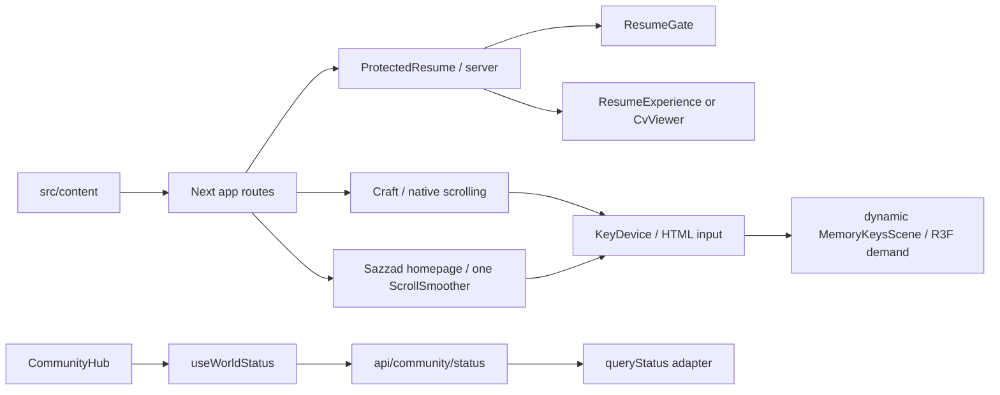

> V1.2 当前验收和部署以 ZOOM_25_TO_500_ACCEPTANCE.md、DEPLOY_CLOUD_UBUNTU_NGINX.md、GITHUB_PAGES_MANUAL_NO_GIT.md、CODE_ARCHITECTURE.md 为准。下文保留为旧版本历史，不代表本轮状态。

# 架构

`src/app/craft/page.tsx` 与 `src/app/en/craft/page.tsx` 是独立路由，避免将 Craft 引入英文 catch-all 的首页包。Craft 使用 ReadingShell 和原生滚动，没有第二个 ScrollSmoother。主页只有 Portfolio.tsx 的 SmoothScroller 创建、暂停和释放平滑滚动。

事实来自 content 的 profile、projects、experiences、worlds 和 media；projects-en 与 experience-localized 为语言适配层。图片登记提交、尺寸和来源链接，不将艺术封面当作产品截图。Community 的公告、活动和截图独立于实时状态；没有适配器时 queryStatus 返回 planned。

KeyDevice 是语义输入与渲染资格边界；MemoryKeysScene 管理 Canvas、投影和共享几何；KeycapModel 管理物体的 GSAP 按压。Craft 的 demo 模式拦截经历导航，单键仍使用同一模型。隐藏/离开视口时 Canvas 卸载，模型几何在 effect 清理中 dispose；纹理由 useLoader 缓存复用。

Resume 私有文件只由 server-only 的 resume-access.ts 和 API 路由读取。受保护组件先校验 Cookie，再渲染客户端内容。配置缺失时拒绝，不提供公开 PDF 回退。

reading-return.ts 保存同路由阅读位置，return-home.ts 和 experience-return.ts 负责首页作品/经历返回。Craft 的媒体只增加当前 URL 的 media 查询状态，保留 Next history.state，popstate 处理关闭和前进恢复，不创建全站路由转场管理器。

## Release Candidate 边界

site-config.ts 在构建和服务启动时验证 SITE_MODE/SITE_URL。根元数据仍 noindex。生产 CSP 在 next.config.ts 区分开发；私有 Resume 保持 force-dynamic、server-only 读取和 tracing 排除。CommunityHub 的世界选择/临时反馈由 useWorldSelection 管理，状态翻译在 status-labels；Resume 的对话框动画由 useResumeMediaDialog 独立拥有。CraftShell 仍与项目/简历导航隔离。没有新增运行依赖。
